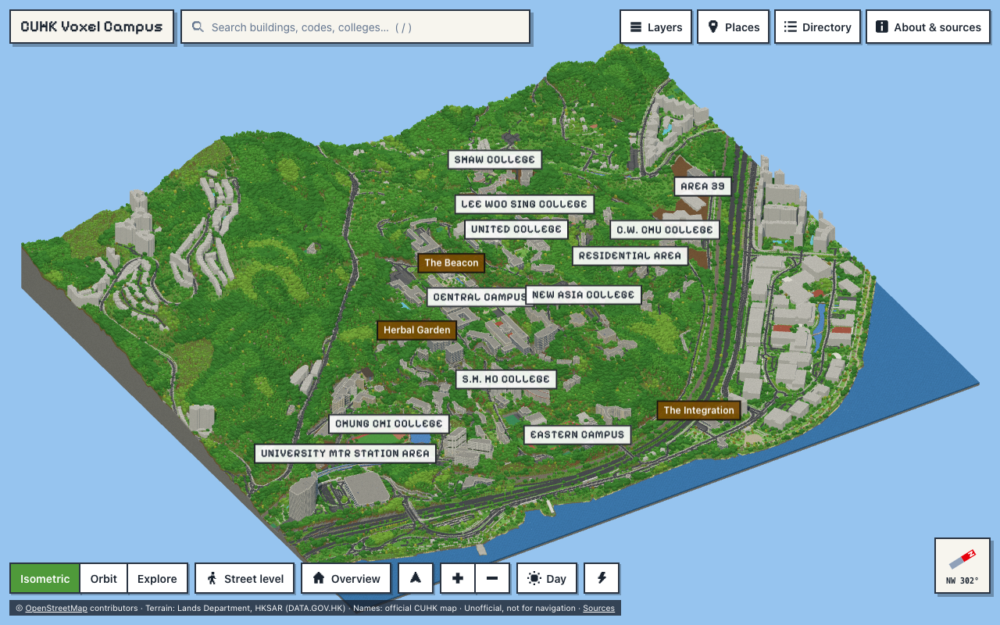

# CUHK Voxel Campus

**A data-informed block-scale digital recreation of The Chinese University of Hong Kong.**

A standalone interactive website that presents the CUHK Sha Tin campus as one connected, explorable
voxel world: block-stepped real terrain, real road and path networks, building footprints rebuilt
as block architecture, dense subtropical woodland, day / sunset / night lighting — in the visual
spirit of a high-end block-building campus showcase, at **1 block = 1 metre**.

It is **not** a game world, mod, server or download, it needs no game installation, and it uses
**no game assets**: every texture is generated procedurally in [`src/lib/voxel/textures.ts`](src/lib/voxel/textures.ts).

**Live site: <https://cuhk-campus.vercel.app>**

> Unofficial. Not affiliated with or endorsed by CUHK. **Not for navigation, accessibility
> planning, safety or operational decisions.** See [docs/ACCURACY.md](docs/ACCURACY.md).



## What you can do

- Land on an orthographic three-quarter overview of the whole campus, then orbit, pan and zoom.
- Switch between **Isometric** (orthographic), **Orbit** (perspective) and **Explore** (first-person
  walk / run / fly with terrain following and building collision), plus **Street level**.
- Search by English or Chinese name, official code (`LSK`, `H3`…), college, landmark, road or stop;
  the camera flies there, the building pulses and an inspector opens.
- Click any building for its official name, codes, zone, model tier, geometry and height confidence.
- Toggle layers (labels, terrain, buildings, trees, roads, paths & stairs, landmarks, points of
  interest, campus zones, source-confidence overlay), time of day and performance mode.
- Share the exact view: the URL always encodes camera, selection, layers and time.

## Local setup

Requires Node.js 20+ (developed on Node 22 LTS).

```bash
npm install
```

```bash
npm run dev
```

Open the printed `http://localhost:5173`. The repository ships the generated world in
`public/world/`, so the site runs immediately — no data download is needed just to view it.

## Commands

| Command | What it does |
| --- | --- |
| `npm run dev` | Development server |
| `npm run build` | Type-check and produce the static production build in `dist/` |
| `npm run preview` | Serve the production build locally |
| `npm run typecheck` | TypeScript project check |
| `npm run lint` | ESLint |
| `npm run format` | Prettier |
| `npm test` | Unit tests (Vitest): projection, landmark coordinates, height hierarchy, mesher, world data, search |
| `npm run test:e2e` | Playwright end-to-end tests against the production build |
| `npm run data:fetch` | Refresh spatial data: OSM extract, official CUHK names, Lands Department terrain |
| `npm run data:process` | Raw OSM → clean grouped GeoJSON in `data/processed/` |
| `npm run data:terrain` | Crop and resample the terrain model to the campus grid |
| `npm run data:world` | Build the block world into `public/world/` |
| `npm run data:build` | `data:process` + `data:terrain` + `data:world` |
| `npm run data:all` | `data:fetch` + `data:build` |

First-time end-to-end setup: `npx playwright install chromium`.
Documentation screenshots: `SHOTS=1 npx playwright test e2e/screenshots.spec.ts`.
Frame-rate probe: `PERF=1 npx playwright test e2e/perf.spec.ts`.

## Data refresh workflow

1. `npm run data:fetch` — one bounded Overpass query for the study-area polygon (cached in
   `data/raw/osm-cuhk.json` with the query text and timestamp), the official CUHK map location
   database, and the Lands Department 5 m terrain model (~29 MB download, ~300 MB unpacked).
   Cached files are reused; pass `--force` to a fetch script to refresh. `data/raw/` is git-ignored.
   The campus boundary (`data/campus-boundary.geojson`) is treated as curated and never overwritten.
2. `npm run data:build` — regenerates `data/processed/*`, `data/terrain/*` and `public/world/*`.
3. `npm test` — the landmark-coordinate, grounding and tree-placement tests validate the new world.
4. Review `data/processed/build-report.json` (official ↔ OSM matches) and record any correction in
   [`data/manual-overrides.json`](data/manual-overrides.json) — every entry needs evidence,
   confidence, reason and date, or the build fails.

The published site never queries Overpass or any map service at runtime.

## Deployment (Vercel)

The site is fully static.

1. Push the repository to GitHub / GitLab / Bitbucket.
2. In Vercel choose **Add New → Project** and import the repository.
3. Vercel detects Vite. The included [`vercel.json`](vercel.json) sets build command
   `npm run build`, output directory `dist`, and cache headers. No environment variables.
4. Deploy. (CLI alternative: `npx vercel` for a preview, `npx vercel --prod` for production.)

Netlify and Cloudflare Pages work the same way: build `npm run build`, publish `dist`
(`public/_headers` provides cache headers for both).

## Source attribution

- Map geometry © [OpenStreetMap](https://www.openstreetmap.org/copyright) contributors, ODbL 1.0.
- Terrain: Digital Terrain Model (5 m) © The Government of the Hong Kong SAR, Lands Department,
  via DATA.GOV.HK.
- Building names, codes, zones, landmark and shuttle-stop points: the official
  [CUHK Campus Map](https://www.cuhk.edu.hk/english/campus/cuhk-campus-map.html),
  © The Chinese University of Hong Kong (facts only; not an open dataset).
- Pixelify Sans typeface, SIL OFL 1.1.

Full details, licence status and restrictions: [docs/DATA_SOURCES.md](docs/DATA_SOURCES.md) and
[`data/source-manifest.json`](data/source-manifest.json).

## Performance notes

- Geometry is drawn as GPU-instanced block quads (12 bytes per merged rectangle) — terrain is
  meshed in a Web Worker, nearest chunks first, so the page never freezes while loading.
- Terrain has two levels of detail; trees have three; small props are distance-culled; the
  shadow map is re-rendered only when something changes.
- Measured on an Apple M5 at 1280×800: 60 fps (v-sync capped) in overview, close orbit and street
  level, 1.9–2.9 M triangles per frame. **Performance mode** (auto-enabled on touch devices)
  thins trees, disables shadows, props and clouds, shortens draw distance and lowers resolution.
- Shipped world data ≈ 2.3 MB of binary plus a 0.55 MB feature catalogue (before HTTP compression).

## Limitations

- Architecture is stylised; only ten landmarks have bespoke models. Heights are often estimates:
  98 of the 165 detailed campus buildings have no height or floor count in public data and use a
  typical value for their type.
- OpenStreetMap coverage, the terrain model and the official map have different dates and accuracy.
- Interiors, signage text, vehicles and people are not modelled; lamps and trees are placed by rule.
- Three official buildings have no OSM footprint and are absent (see `build-report.json`).
- See [docs/ACCURACY.md](docs/ACCURACY.md) for the full list.

## Documentation

- [docs/DATA_SOURCES.md](docs/DATA_SOURCES.md) — every source, licence and attribution
- [docs/ACCURACY.md](docs/ACCURACY.md) — what is and is not accurate, validation results
- [docs/ARCHITECTURE.md](docs/ARCHITECTURE.md) — coordinates, pipeline, chunking, rendering
